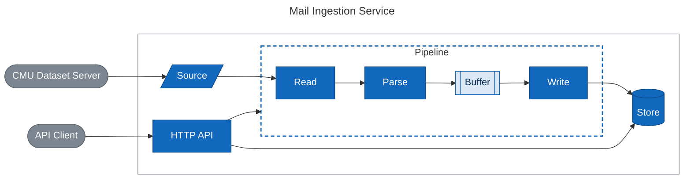
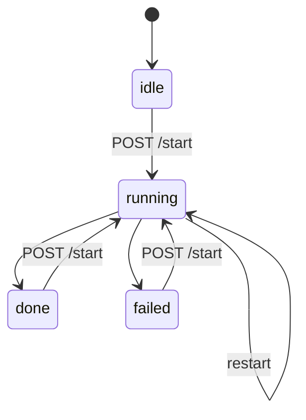

# Design

## Problem

Count the messages and senders in a mail archive, and report the progress and the top senders while it runs. The archive may be larger than memory, and a run may be interrupted by a crash, a restart or a lost connection. The service must finish anyway, with exact counts, and without starting over.

## Chunked Commits

The service reads the archive as a stream and cuts it into chunks of at most 1,000 mail files, 4 MiB or one second. Each chunk is committed to SQLite in one transaction, together with the progress. That one choice does two jobs.

Memory is bounded. Only a few chunks are in flight at a time, and everything already counted is on disk. The dataset's size changes the database, not the memory.

Recovery is cheap. A commit means the first N mail files are done. After a restart, the service opens the archive again, skips N mail files and continues. A lost connection takes the same path.

## What a Message Is

The Enron archive has 517,401 mail files, but many are copies of the same email in different folders. Each copy got its own `Message-ID`, so `Message-ID` finds no duplicates at all. The service identifies a message by a hash of its sender, date, subject, recipients and normalized body instead. That collapses the copies into 254,791 messages.

## Choices

- **SQLite**, one file per ingestion. Upserts are native, and a full disk fails cleanly.
- **Two goroutines**, Read and Parse in one, Write in the other, joined by one buffer and committed in order. gunzip is the bottleneck, not parsing, so parsing needs no goroutine of its own and parallel parsing would not help.
- **Five header fields** are kept, each capped at 128 KiB, so no mail file can grow memory.
- **SSE on `/status`**, with JSON for clients that poll.
- **One replica**, because two writers would count every message twice.
- **Fixed limits.** SQLite's heap and the stream cap are fixed defaults, and compose sets `GOMEMLIMIT` next to the memory limit, the standard way to bound a Go process.
